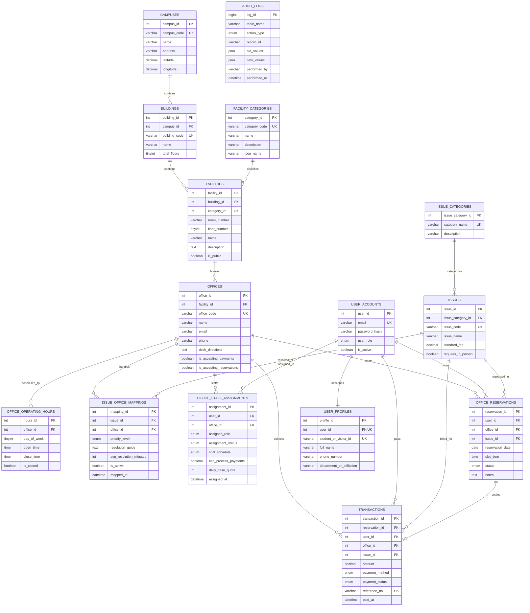

# How to Generate the UniDesk Schema in draw.io (diagrams.net)

You can generate the complete **UniDesk Database Schema** in **[draw.io](https://app.diagrams.net/)** (or the draw.io desktop app / VS Code extension) using either of two methods:

---

## ⚡ Method 1: Instant Mermaid Import (Recommended - Auto-Generates All Crow's Foot Connector Lines)

Using draw.io's built-in Mermaid parser, draw.io will **automatically position the tables and draw all Crow's Foot relationship lines** between entities!

### Step-by-Step Instructions:
1. Open [draw.io (app.diagrams.net)](https://app.diagrams.net/).
2. In the top toolbar, click **`+` (Insert)** > **Advanced** > **Mermaid...**  
   *(Or from the top menu bar: **Arrange** > **Insert** > **Advanced** > **Mermaid...**)*.
3. Replace any existing text in the dialog box by pasting the code below (or from [`docs/drawio_schema.mermaid`](file:///c:/Users/harne/.gemini/antigravity-ide/scratch/unidesk-database-system/docs/drawio_schema.mermaid)):

4. Click **Insert**.
5. Draw.io will instantly generate the entities and all Crow’s foot connector lines on your canvas.

---

## ⚡ Method 2: Direct SQL Import in draw.io (Native Entity Table Shapes)

If you prefer draw.io's native SQL database entity shapes:

### Step-by-Step Instructions:
1. Open [draw.io (app.diagrams.net)](https://app.diagrams.net/).
2. In the top toolbar, click **`+` (Insert)** > **Advanced** > **SQL...**  
   *(Or: **Arrange** > **Insert** > **Advanced** > **SQL...**)*.
3. Copy all lines from [`docs/drawio_schema.sql`](file:///c:/Users/harne/.gemini/antigravity-ide/scratch/unidesk-database-system/docs/drawio_schema.sql) and paste them into the dialog box.
4. Click **Insert**.
5. Draw.io will instantly build all 15 table shapes with columns, primary key icons, and data types!
