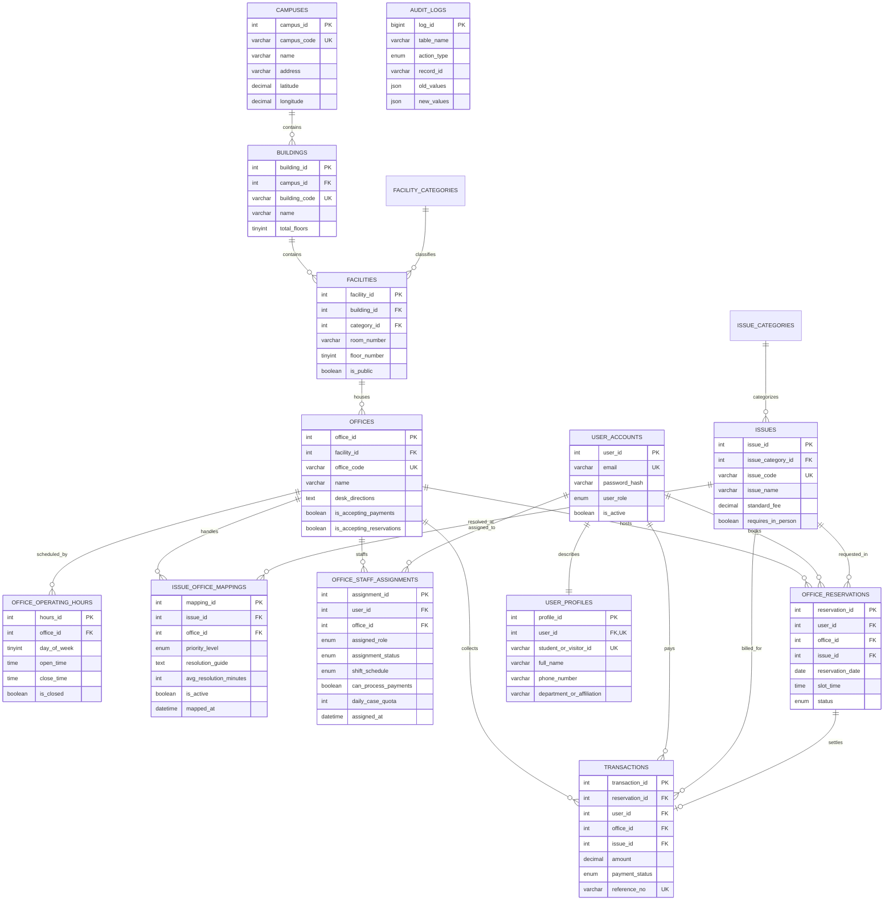

# How to Import UniDesk Schema into Lucidchart

You can import the **UniDesk Database Schema** into [Lucidchart](https://www.lucidchart.com) using either of the two standard methods below.

---

## ⚡ Option 1: Native Lucidchart ERD File Import (Recommended - Full Interactive ERD)

Lucidchart can automatically build your ER diagram with draggable tables, field types, primary keys, and crow's foot relationships using our pre-generated schema metadata file:

### Ready-to-Use Import Files
- **TSV Format**: [`docs/lucidchart_erd_import.tsv`](file:///c:/Users/harne/.gemini/antigravity-ide/scratch/unidesk-database-system/docs/lucidchart_erd_import.tsv)
- **CSV Format**: [`docs/lucidchart_erd_import.csv`](file:///c:/Users/harne/.gemini/antigravity-ide/scratch/unidesk-database-system/docs/lucidchart_erd_import.csv)

### Step-by-Step Instructions:
1. Open a new or blank document in [Lucidchart](https://lucid.app).
2. On the left sidebar, click **"+ More shapes"** (or press `M`) and ensure the **"Entity Relationship"** shape library is enabled.
3. At the bottom of the Entity Relationship shape list on the left, click **"Import"** (or click **"Create from data"** in the top search bar and choose **Entity Relationship (ERD)**).
4. Select **MySQL** from the Database Management System (DBMS) dropdown.
5. Click **Next**.
6. On the next screen, click **"Choose File"** and upload [`docs/lucidchart_erd_import.csv`](file:///c:/Users/harne/.gemini/antigravity-ide/scratch/unidesk-database-system/docs/lucidchart_erd_import.csv) (or [`docs/lucidchart_erd_import.tsv`](file:///c:/Users/harne/.gemini/antigravity-ide/scratch/unidesk-database-system/docs/lucidchart_erd_import.tsv)), OR select the text box and paste the text contents directly.
7. Click **Import**.
8. All 15 database tables will appear in your left-hand ERD shapes drawer.
9. Drag the tables onto your canvas (or click **"Select All" / "Add All"**). Lucidchart will automatically generate and connect all relationship lines and foreign keys!

---

## ⚡ Option 2: Direct Mermaid Import (Fastest - 10 Seconds)

Lucidchart includes native Mermaid code rendering.

### Step-by-Step Instructions:
1. Open a blank document in Lucidchart.
2. In the top navigation menu, click **File** > **Import Data** > **Mermaid** (or in the left tool tray, click the **+ Insert** button > **Mermaid**).
3. Paste the Mermaid ERD code block below into the code editor.
4. Click **Insert Diagram**. Lucidchart will automatically draw and organize the diagram on your canvas.

